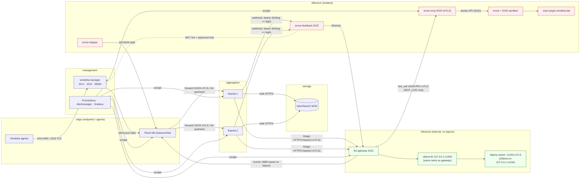

# Phase 2 — System Topology & Manifest

Scope: the complete skeleton of `vendetta-stack/` — Vendetta (defense), Errow (offense, bidirectional), and the sovereign LLM tier —
before/alongside implementation. Every path below exists in the repository; `tests/check-manifest.sh` fails if one is missing.
Companion documents: [`PHASE1-GAP-ANALYSIS.md`](PHASE1-GAP-ANALYSIS.md) (gaps, mappings, decisions), [`runbooks.md`](runbooks.md), [`capacity.md`](capacity.md).

## 1. Directory manifest

```text
vendetta-stack/
├── docker-compose.yml                     # all services; profiles: mock-llm llm errow lab manager dashboards nginx-lb test
├── docker-compose.gpu.yml                 # NVIDIA passthrough overlay for the real Ollama worker
├── .env.example                           # every variable, safe defaults, image digests pinned
├── .env.smoke                             # smoke-test overrides (legs -> sink stub, mock models, everything dry-run)
├── fluent-bit/                            # Tier 1 — edge collection (3.2.10)
│   ├── fluent-bit.conf  parsers.conf  plugins.conf  streams.conf  upstream.conf
│   ├── stream_processors.lua              # MITRE enrichment + cs3-otlp-normalize equivalent (Stage-1 guardrail)
│   ├── entrypoint.sh                      # renders legs/ + inputs/ into enabled.d/ from env, validates, execs
│   ├── conf.d/   05-inputs-test-hook  10-vendetta-agents  20-errow-findings  30-errow-runs  40-errow-llm-logs
│   │             50-errow-mcp-events  55-errow-runtime  60-ai-tier  70-filters-global  90-outputs
│   ├── legs/     10-console  20-esoc  30-siem   # CS3 §4.3 legs; Console leg cannot match cs3.ai.*
│   └── inputs/   caido  cfgaudit  errow-reports  host-audit  host-auth  syslog  systemd  systemd-all
├── cfgaudit/                              # optional offline network-config auditor (manual Compose ingestion only)
│   ├── cfgaudit/  engine  adapter  shadow  batfish_bridge  gui  schemas/{finding,run}.schema.json
│   ├── tests/  samples/  pyproject.toml  README.md             # source only; no prebuilt/unsigned binaries
├── fluentd/                               # Tier 2 — aggregation (1.17), two active-active nodes
│   ├── fluent.conf  Dockerfile  entrypoint.sh
│   ├── conf.d/   00-source-forward  10-filter-vendetta-alerts  11-filter-errow-findings  12-filter-ai-inference
│   │             13-filter-ai-ollama  15-routing  20-match-opensearch  21-match-opensearch-errow
│   │             22-match-opensearch-llm-audit  23-match-opensearch-cfgaudit  30-match-prometheus  40-out-http-feedback-loop
│   │             45-out-http-llm-triage  50-esoc-siem-label  60-error-unrouted
│   ├── optional/ errow-cloud  esoc  siem  vendetta-execd-{dry-run,live}  (+ *-null stubs)
│   ├── edge/forwarder.conf                # Fluentd as an edge forwarder (hosts where Fluent Bit is not used)
│   └── plugins/  Gemfile  Gemfile.lock  out_http_bearer.rb  out_otlp_http.rb
├── opensearch/                            # Tier 3 — storage/search (2.17.1)
│   ├── opensearch.yml  opensearch.single-node.yml  cluster-settings.json  apply.sh  entrypoint.sh
│   ├── ism-policies/       hot-warm-cold  rollover-40gb  errow-findings-retention  cs3-ai-audit-retention
│   │                       cfgaudit-findings-retention  cfgaudit-runs-retention
│   ├── index-templates/    vendetta-alerts  errow-findings  errow-runs  errow-transcripts  errow-threat-models
│   │                       errow-generic  cs3-ai-inference  cs3-ai-audit  cfgaudit-findings  cfgaudit-runs
│   ├── ingest-pipelines/   sarif-to-vendetta-alert  errow-finding-enrichment  aiincident-to-vendetta-alert  vendetta-alerts-router
│   ├── security/           roles, role mappings, tenants, audit, allow-list (security plugin ON)
│   └── dashboards/         opensearch_dashboards.yml  saved-objects.ndjson  import.sh
├── ollama/                                # Tier 4 — sovereign inference
│   ├── models.json                        # 8 mandatory keys; sha256 pinned per release by scripts/pin-model-digests.mjs
│   ├── install-ollama.sh  cs3-ollama.service  com.cecur-it.cs3-ollama.plist  detect-hardware.mjs
│   ├── install-llama.cpp.sh  cs3-llama-cpp.service                       # non-CUDA / air-gap fallback
│   ├── Dockerfile.ollama  entrypoint.sh  pull-models.sh  modelfiles/
│   ├── mock/mock_ollama.py                # stdlib stand-in used by CI and the smoke test
│   └── ollama-lb/   haproxy.cfg  nginx.conf  worker-proxy.cfg
├── llm-gateway/                           # Stage-2 guardrails + failover + metering + MCP policy enforcement
│   ├── Dockerfile  server.py  guardrails.py  failover.py  meter.py  audit.py  policy.py  mcp.py  schema.py ...
│   ├── mcp_policy.yaml                    # authoritative MCP allow-lists (copy kept in sync at errow/mcp/policy.yaml)
│   ├── schemas/ai_incident_analysis.schema.json
│   └── tests/                             # hermetic pytest suite
├── errow/                                 # offense, bidirectional
│   ├── Dockerfile.errow  Dockerfile.sandbox  entrypoint.sh  stack-config.py  README.md
│   ├── config/   errow-config.yaml  llm-providers.yaml  scan-target.nginx.conf   # llm-providers points at the gateway, never a hosted API; scan-target = lab profile target
│   ├── viewer/   deployment.yaml  frontend-build.sh
│   ├── tui/      sidecar-deployment.yaml  bridge/            # Go bridge: socketpair FD -> Fluent Bit forward
│   ├── mcp/      mcp-server.yaml  policy.yaml  server.py ... # errow-mcp bridge (Errow's tools/mcp is a client)
│   ├── shipper/  shipper.py ...                              # errow-shipper: rewritten JSON artifacts -> NDJSON
│   └── feedback-loop/  vendetta-to-errow.sh  errow-to-vendetta.sh  schema-validate.py  APPROVALS.md  server.py
├── vendetta/                              # Vendetta-side hooks
│   ├── ossec-hooks.conf                   # the manual manager ossec.conf changes (jsonout, alert level, AR command)
│   ├── manager/                           # CS3 rule block 10120-10199, decoders, boot-time ossec.conf splice
│   ├── active-response/host-isolate.sh     # agent-side isolate/un-isolate (nft/iptables, allow-list gated)
│   └── tests/test_host_isolate.sh
├── prometheus/  prometheus.yml  alerts.yml  alertmanager.yml  runbook-anchors.txt
├── grafana/     provisioning/{datasources,dashboards}  dashboards/{pipeline-health,vendetta-overview,errow-offense,llm-slo}.json
├── kubernetes/
│   ├── helm/vendetta-stack/               # Chart.yaml values{,-onprem,-airgap}.yaml templates/
│   └── kustomize/overlays/{dev,onprem,airgap}/
├── scripts/  bootstrap  enroll-agent  enroll-errow  enroll-ollama  rotate-certs  backup-opensearch
│             build-airgap-bundle  verify-bundle  healthcheck  sync-mcp-policy  validate-models-json  pin-model-digests.mjs
├── docs/     PHASE1-GAP-ANALYSIS  PHASE2-TOPOLOGY  runbooks  capacity
└── tests/    smoke-test.sh  validate-pipeline.py  check-manifest.sh  stubs/sink.py
              synthetic-logs/  (vendetta-alert  vendetta-fim  errow-finding.sarif  errow-run  errow-llm-request
                                errow-threat-model  errow-mcp-tool-call  ai-incident-analysis)
              llm/  test_prompt_injection  test_json_schema  test_failover
```

Deviations from the spec's tree (all deliberate; reasons in Phase 1): `errow/Dockerfile.sandbox` (the stock sandbox lacks gobuster/bbot),
`errow/shipper/` and `errow/mcp/` (shims for gaps G-05/G-06), `fluentd/edge/`, `fluent-bit/legs|inputs/` (env-rendered include lists),
`opensearch/security/`, `ollama/mock/`, and the `vendetta/` hook directory.

## 2. Network zones and security boundaries



Boundary rules enforced by configuration (not convention):

| # | Boundary | Enforced by |
|---|---|---|
| B1 | Only the gateway speaks to `11434` | Ollama binds `127.0.0.1`; the LB shares the gateway's network namespace; workers expose only the mTLS proxy `:11443`; `inference` network is `internal: true`; K8s NetworkPolicy allows `:11443` from gateway pods only |
| B2 | No LLM egress to hosted providers | gateway FailClosed (`CS3_PROFILE=onprem|airgap` + any hosted key ⇒ exit 3); `inference` network has no gateway to the internet; air-gap NetworkPolicy has no external egress |
| B3 | Errow can never reach Vendetta `1514/1515/1516/55000`, Ollama `11434`, OpenSearch `9200/9300` | `offensive` network is separate; `mcp_policy.yaml` `denied.ports`; K8s NetworkPolicy; sandbox containers run in DinD without those routes |
| B4 | `cs3.ai.ollama` never reaches Console, OpenSearch, `/triage` | Fluent Bit Console leg `Match_Regex` excludes `cs3.ai.*`; Fluent Bit forward output regex excludes it; Fluentd `15-routing.conf` + `50-esoc-siem-label.conf`; gateway `/triage` returns 400 (tests assert all four) |
| B5 | Offensive actions are dry-run by default | `MCP_LIVE=false`, `ERROW_FEEDBACK_LIVE=false`; live additionally needs a signed `APPROVALS.md` line (HMAC) |
| B6 | Untrusted telemetry never reaches a model unsanitized | Stage 1 Lua at the edge, Stage 2 gateway (`<untrusted_data>` framing, injection scan, 8000-char cap, strict schema validation of output) |
| B7 | Audit integrity (NIST AU-9) | hash-chained gateway events, `create`-only writes (409 on duplicates), ISM write-block after 1 day, 7-year retention with snapshot before delete |

## 3. Data-flow protocol table

| # | Source | Destination | Protocol / port | AuthN / encryption | Buffering & failure mode |
|---|---|---|---|---|---|
| 1 | Vendetta agent | `vendetta-remoted` | TCP 1514 | per-agent key, AES-256 | agent-side queue + leaky bucket (`events_per_second`) |
| 2 | Vendetta agent | `vendetta-authd` | TCP 1515 | TLS, password/`authd.pass` | enrollment retried by `scripts/enroll-agent.sh` |
| 3 | manager ↔ manager | `vendetta-clusterd` | TCP 1516 | cluster key | manager network only, never published |
| 4 | operators / Fluentd (live execd) | Manager API | HTTPS 55000 | JWT, RBAC | live only; default routed to dry-run log |
| 5 | `vendetta-analysisd` | `alerts.json` file → Fluent Bit `tail` | file | filesystem permissions (ro mount) | tail DB offsets; resumes after restart |
| 6 | Fluent Bit | Fluentd ×2 | Forward 24224 | mTLS (Fluentd enforces client cert), CA `/pki/ca.crt` | filesystem buffer, `Retry_Limit False`, `storage.pause_on_chunks_overlimit on`, `upstream.conf` HA |
| 7 | Fluent Bit | Console leg | HTTPS 443 `/api/cecur/logs/ingest` | `X-API-Key` (secret file) | batch ≤1000/2 MB; retries; structurally excludes `cs3.ai.*` |
| 8 | Fluent Bit | ESOC OTLP (leg 2) | gRPC 4317 mTLS (Fluentd's optional ESOC leg uses OTLP/HTTP-JSON instead) | client cert | retry; carries `cs3.ai.ollama` |
| 9 | Fluent Bit | SIEM NDJSON (leg 3) | HTTPS 443 | Bearer (secret file) | retry; carries `cs3.ai.ollama` |
| 10 | Fluent Bit | local safety file | file | — | `cs3-ai-ollama.ndjson` size-rotated; last line of defense for loop prevention |
| 11 | Ollama journald | Fluent Bit `systemd` input | journal | read-only mount | retagged `cs3.ai.ollama` |
| 12 | `errow-shipper` | `/var/log/errow/<stream>.ndjson` → Fluent Bit `tail` | file | ro mount | content-hash dedupe (idempotent) |
| 13 | `errow` TUI | TUI bridge → Fluent Bit forward | socketpair FD → 24225 | in-container | bridge-local queue |
| 14 | Fluentd | OpenSearch | HTTPS 9200 bulk | basic auth (secret file) + CA | file buffer, `retry_forever`, `overflow_action block`, dead-letter |
| 15 | Fluentd | `llm-gateway` `/triage` | HTTPS 9101 | bearer + client cert | best-effort `drop_oldest_chunk` (triage is advisory; heuristics cover the gap) |
| 16 | Fluentd | `errow-feedback` | HTTP 9102 | bearer | `retry_forever`; findings ≥ high only |
| 17 | Fluentd | Errow cloud (optional) | HTTPS | bearer | only when `ERROW_CLOUD_ENABLED=true` |
| 18 | `errow-feedback` | `llm-gateway` `/forensic` | HTTPS 9101 | bearer | advisory; failure never blocks isolate/ticket/retest |
| 19 | `llm-gateway` | `ollama-lb` | HTTP 127.0.0.1:11434 (same netns) | loopback | HAProxy queue 30 s, `maxconn` per worker |
| 20 | `ollama-lb` | workers | HTTPS 11443 | mTLS, `verify required` | active health check `/api/tags` |
| 21 | worker proxy | Ollama | HTTP 127.0.0.1:11434 | loopback | — |
| 22 | `llm-gateway` | Fluent Bit | HTTP 9880 `/<tag>` | in-network | durable on-disk spool + hash chain |
| 23 | `llm-gateway` | `errow-mcp` | MCP JSON-RPC over HTTPS 9103 | mTLS + policy re-check | `MCP_LIVE=false` ⇒ dry-run plan only |
| 24 | `errow-mcp` | DinD → sandbox | Docker API | TLS to DinD | ephemeral container per call |
| 25 | `errow` | `llm-gateway` `/v1/chat/completions` | HTTPS 9101 | bearer | model allow-list, temp 0.2 |
| 26 | Prometheus | Fluent Bit 2020, Fluentd 24231, gateway 9101, errow-mcp 9103 | HTTP(S) scrape | per target | `alerts.yml` + runbooks |
| 27 | Grafana / Dashboards | Prometheus / OpenSearch | HTTP(S) | datasource creds from secrets | — |
| 28 | Operators | Errow Viewer | HTTP 8765 (behind Ingress auth) | per-process `?token=` cookie | single replica by design |
| 29 | Operators | Dashboards 5601 / Grafana 3000 | HTTPS | SSO/basic | — |

## 4. High availability — active-active model

| Layer | Topology | Failure behavior |
|---|---|---|
| Fluent Bit | one per host (DaemonSet), disk buffer | Fluentd outage ⇒ buffer to `FLB_FORWARD_STORAGE_LIMIT` (2 G) then input pause (no drop for tail inputs) |
| Fluentd | **two independent aggregators**, no shared state; edge `upstream.conf` balances round-robin with health checks; `heartbeat_type tcp`, `phi_threshold` failure detection | one node down ⇒ the other serves everything; each node drains its own file buffer on restart; stable document ids make replays idempotent; K8s adds a `Service` + PDB (`minAvailable: 1`), anti-affinity |
| Load balancer | L4 `Service` (K8s) or Fluent Bit's own upstream (Compose); out-of-cluster edge nodes use `fluentd/edge/forwarder.conf` with the same two-node upstream | no single LB; Fluentd nodes are interchangeable |
| OpenSearch | 3 nodes (K8s) / single-node (smoke), ISM hot-warm-cold, snapshots | quorum of 2; shard-allocation awareness documented in `opensearch/RUNTIME.md` |
| LLM gateway | ≥ 2 replicas, per-replica hash chain (`chain_id`), own spool volume | replica loss only loses in-flight requests; callers retry |
| Ollama | N workers behind HAProxy (default) or NGINX | worker down ⇒ queued ≤30 s then tier-2 model ⇒ tier-3 heuristics; SOC never stalls |
| Errow | stateless runner; viewer is one replica per run (token auth) | scan loss is re-triggerable from the retest queue |

## 5. Deployment topologies

| Topology | Entry point | Notes |
|---|---|---|
| Smoke / dev | `docker compose --env-file .env.smoke --profile mock-llm --profile test --profile lab --profile errow up` | mock Ollama, single-node OpenSearch, legs pointed at the sink stub; `tests/smoke-test.sh` automates it |
| Single-host on-prem | Compose + `docker-compose.gpu.yml` + `--profile llm` | real Ollama on the GPU; HAProxy LB; `CS3_PROFILE=onprem` |
| Kubernetes (cloud/on-prem) | `kubernetes/helm/vendetta-stack` (+ `values-onprem.yaml`) | cert-manager, external-secrets, ServiceMonitors, NetworkPolicies, PDBs, HPA, GPU node pool |
| Air-gap | `values-airgap.yaml` / `overlays/airgap` + `scripts/build-airgap-bundle.sh` | images pre-loaded, weights pinned by SHA-256, SBOM + cosign verification (`scripts/verify-bundle.sh`), no external egress |
| Constrained / non-CUDA edge | `ollama/install-llama.cpp.sh` | GGUF fallback with the same pins; probe `/v1/models` (no `/api/tags`) |

## 6. Image and version pinning

All images are `name:tag@sha256:digest` from `.env.example`; Fluent Bit **3.2.10**, Fluentd **1.17.1**, OpenSearch/Dashboards **2.17.1**, Prometheus **2.55.1**, Alertmanager **0.27.0**, Grafana **10.4.19**, Ollama **0.40.5**, HAProxy 3.0, NGINX 1.27, Python 3.12. `scripts/lib/images.sh` verifies that Compose, Helm values and the air-gap bundle agree.

## 7. Vendetta integration hooks (`ossec.conf` and active response)

The stack never regenerates `ossec.conf`, `internal_options.conf` or `cluster.json`; it only needs the following on the **manager** (snippet: `vendetta/ossec-hooks.conf`):

| Hook | Setting | Why |
|---|---|---|
| JSON alert log | `<global><jsonout_output>yes</jsonout_output><alerts_log>yes</alerts_log></global>` | Fluent Bit tails `alerts/alerts.json` (`vendetta-logs` volume, read-only) |
| Alert threshold | `<alerts><log_alert_level>3</log_alert_level></alerts>` | keeps `info` noise out of the pipeline; the LLM path only sees medium+ (`LLM_TRIAGE_VENDETTA_SEVERITY_REGEX`) |
| Active response command | `<command><name>host-isolate</name><executable>host-isolate.sh</executable><timeout_allowed>no</timeout_allowed></command>` | target of Fluentd's live execd leg (`ERROW_FEEDBACK_AR_COMMAND=!host-isolate.sh`); script: `vendetta/active-response/host-isolate.sh` (refuses to run without a manager allow-list) |
| Syslog receiver (CS3 block) | `<remote><connection>syslog</connection><port>5140</port><protocol>udp</protocol></remote>` bound to loopback | Fluent Bit copies `host.syslog`/`host.auth`/`host.audit`/`host.network`/`host.endpoint` here so endpoint and network logs pass the decoder/rule engine instead of bypassing it; spliced at boot by `vendetta/manager/patch-ossec-conf.sh` |
| CS3 rules and decoders | `vendetta/manager/cs3-rules.xml` (`10120-10199`), `cs3-decoder.xml` — installed into `ruleset/rules/9999-cs3-rules.xml` / `etc/decoders/0001-cs3-decoder.xml` at boot | the receiver is useless without something to decode and match; IDs are checked for range and collisions before the manager starts |
| CTI feed updater | `CS3_MANAGER_FEED_MODE` (`off` by default) / `CS3_MANAGER_CTI_URL` via `vendetta/manager/configure-feeds.sh` | the stock image resolves `cti.wazuh.com` every 60m, which fails without egress and fills `ossec.log`; `off` disables the updater, `mirror` points it at an internal CTI |
| Custom integrations | `custom-` integrations are **not** used: the alert → gateway path is Fluentd `45-out-http-llm-triage.conf`, which keeps one audited egress point | avoids a second, unbuffered path to the LLM |

The return direction is the `CS3_MANAGER_ENABLED` Fluent Bit leg: `manager.alerts` is tailed from `alerts/alerts.json` and posted to
`POST /api/cecur/manager/alerts`, which keeps rule ID, original event timestamp, agent identity and `rule.level` and deduplicates repeats
inside `CS3_ALERT_DEDUP_WINDOW_S`. The `vendetta.*` streams are deliberately not copied into the receiver — they are already manager output
and would loop. See [`MANAGER-INTEGRATION.md`](MANAGER-INTEGRATION.md) for the failure modes and the full-template override.
| API | RBAC role for `errow-feedback` limited to `active-response:command` on approved agents | live execd uses a JWT minted from `vendetta_api_password` |

Agents are enrolled with `scripts/enroll-agent.sh` (sets `<server><address>`, runs `agent-auth` over 1515); Errow hosts with `scripts/enroll-errow.sh`; Ollama workers with `scripts/enroll-ollama.sh`.
